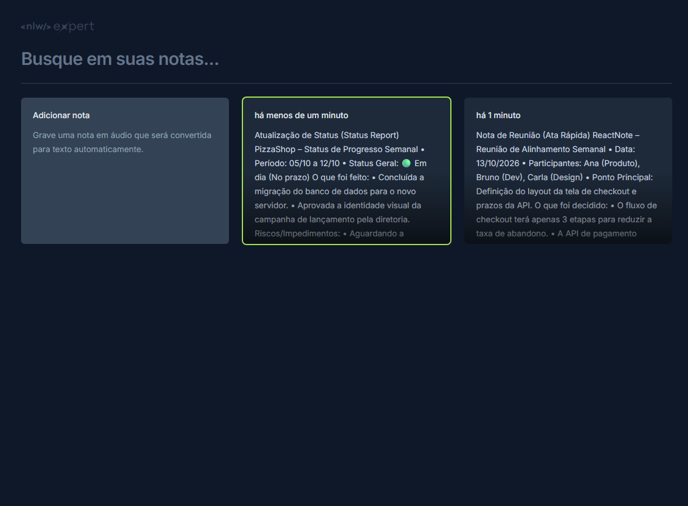

# NotesReact

> Aplicativo de anotações com reconhecimento de voz em tempo real

## Prévia



## Descrição

NotesReact é um aplicativo web modernizado para criação e gerenciamento de notas, construído com **React**, **TypeScript** e **Vite**. O aplicativo permite criar notas por meio de **reconhecimento de voz** (Web Speech Recognition API) ou digitando manualmente, com armazenamento persistente no `localStorage` do navegador.

### Funcionalidades

- **Criação de notas por voz**: Grave notas em áudio que são automaticamente convertidas para texto
- **Criação de notas por texto**: Digite suas notas manualmente
- **Pesquisa em tempo real**: Filtre suas notas por conteúdo
- **Visualização e exclusão**: Veja suas notas e exclua quando necessário
- **Persistência local**: Todas as notas são salvas automaticamente no navegador
- **Design responsivo**: Funciona em desktop e dispositivos móveis
- **Acessibilidade**: Interface acessível com foco visual claro

## Tecnologias Utilizadas

| Tecnologia      | Versão   | Finalidade               |
| --------------- | -------- | ------------------------ |
| React           | ^18.2.0  | Biblioteca de UI         |
| TypeScript      | ^5.2.2   | Tipagem estática         |
| Vite            | ^5.2.0   | Build tool               |
| Tailwind CSS    | ^3.4.3   | Estilização              |
| Radix UI Dialog | ^1.0.5   | Componentes de modal     |
| Sonner          | ^1.4.41  | Notificações toast       |
| Lucide React    | ^0.372.0 | Ícones                   |
| date-fns        | ^3.6.0   | Manipulação de datas     |
| gh-pages        | ^6.1.1   | Deploy para GitHub Pages |

## Pré-requisitos

- Node.js 18+
- npm ou yarn
- Navegador moderno (Chrome, Edge, Firefox, Safari) com suporte à **Web Speech Recognition API**

## Instalação

```bash
# Clonar o repositório
git clone https://github.com/rosendo2015/NotesReact.git

# Entrar no diretório do projeto
cd NotesReact

# Instalar dependências
npm install
```

## Scripts Disponíveis

| Comando           | Descrição                                |
| ----------------- | ---------------------------------------- |
| `npm run dev`     | Inicia o servidor de desenvolvimento     |
| `npm run build`   | Gera a build de produção                 |
| `npm run preview` | Visualiza a build de produção localmente |
| `npm run deploy`  | Faz deploy para GitHub Pages             |

## Uso

### Desenvolvimento Local

```bash
npm run dev
```

Acesse [http://localhost:5173](http://localhost:5173) no seu navegador.

### Produção

```bash
# Gerar build
npm run build

# Iniciar servidor de preview
npm run preview
```

### Deploy para GitHub Pages

```bash
npm run deploy
```

## Estrutura do Projeto

```
NotesReact/
├── public/                 # Arquivos estáticos
├── src/
│   ├── assets/             # Recursos estáticos (logos, imagens)
│   ├── components/
│   │   └── card/           # Componentes de cartão de notas
│   │       ├── NewNoteCard.tsx  # Componente para criar nova nota
│   │       └── NoteCard.tsx     # Componente para exibir nota existente
│   ├── App.tsx             # Componente principal da aplicação
│   ├── index.css           # Estilos globais
│   ├── main.tsx            # Ponto de entrada da aplicação
│   └── vite-env.d.ts       # Tipagens do Vite
├── index.html             # HTML principal
├── package.json           # Dependências e scripts
├── tailwind.config.js     # Configuração do Tailwind CSS
├── tsconfig.json          # Configuração do TypeScript
├── vite.config.ts         # Configuração do Vite
└── README.md              # Este arquivo
```

## API de Reconhecimento de Voz

O aplicativo utiliza a **Web Speech Recognition API**, que está disponível nos principais navegadores:

- ✅ Google Chrome
- ✅ Microsoft Edge
- ✅ Firefox (com prefixo `webkit`)
- ⚠️ Safari (suporte limitado)

Caso o navegador não suporte a API, uma mensagem de aviso será exibida.

## Configuração

### Idioma do Reconhecimento de Voz

O reconhecimento de voz está configurado para **Português do Brasil** (`pt-BR`). Para alterar o idioma, modifique a linha no arquivo `NewNoteCard.tsx`:

```typescript
recognition.lang = "pt-BR"; // Altere para o idioma desejado
```

### Personalização do Design

O projeto utiliza **Tailwind CSS**. Para personalizar cores, fontes ou estilos:

1. Edite o arquivo `tailwind.config.js` para configurar temas globais
2. Modifique as classes Tailwind nos componentes

### Fonte

O projeto utiliza a fonte **Inter** do Google Fonts, importada via CDN no `index.html`.

## Contribuição

Contribuições são bem-vindas! Para contribuir:

1. Faça um fork do projeto
2. Crie uma branch com sua feature (`git checkout -b feature/nova-funcionalidade`)
3. Commit suas mudanças (`git commit -m 'Adiciona nova funcionalidade'`)
4. Push para a branch (`git push origin feature/nova-funcionalidade`)
5. Abra um Pull Request

## Licença

Este projeto é aberto e pode ser utilizado livremente.

## Demo

Acesse a versão em produção em: [https://rosendo2015.github.io/NotesReact](https://rosendo2015.github.io/NotesReact)

---

Desenvolvido com React e TypeScript 🚀
